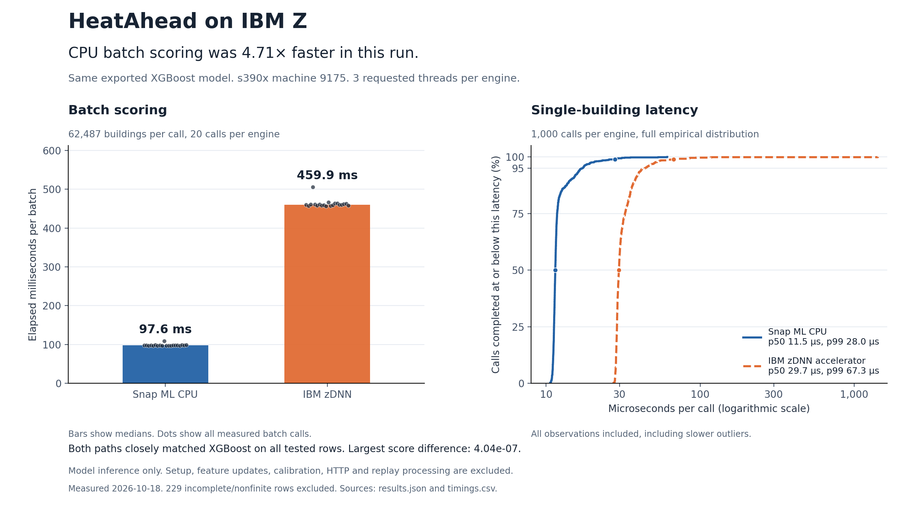
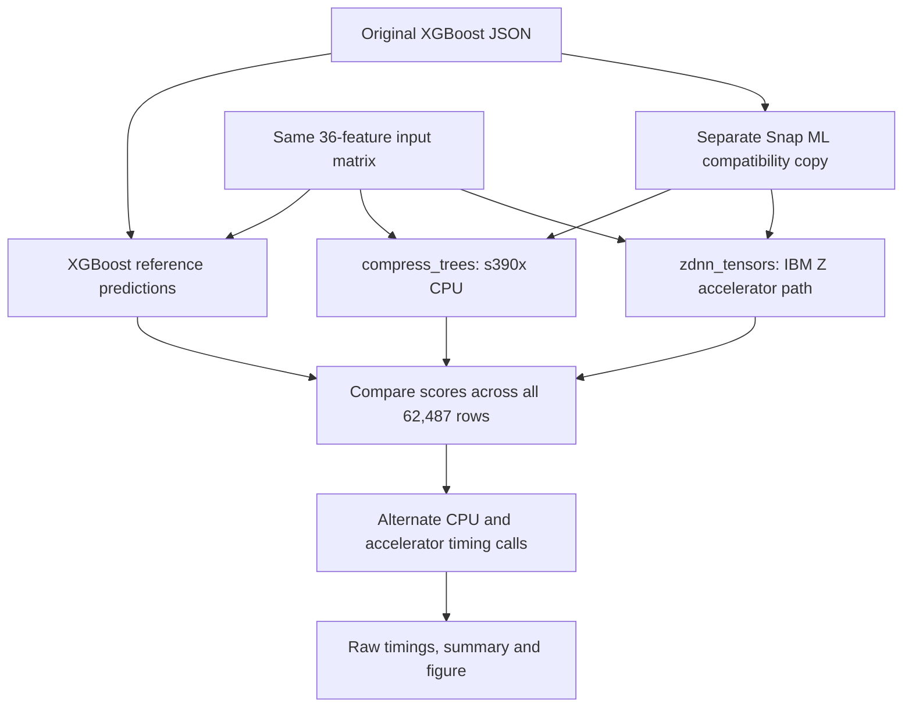

# HeatAhead: Snap ML CPU and IBM zDNN benchmark

On October 18, 2026, HeatAhead's exported daily XGBoost model ran successfully
through both Snap ML's CPU engine and its IBM zDNN accelerator path on a LinuxONE
guest. Both paths closely matched the original model across all 62,487 tested
building rows. CPU batch scoring was **4.71× faster** in this run.

This is a supplementary inference benchmark of one exported model and one
historical feature snapshot. The project's frozen 172,485-row benchmark and
held-out prediction results remain separate measurements.



## Results

Every batch call scored the same 62,487 rows. Throughput is the row count divided
by the median batch duration. Each engine has 20 measured batch calls and 1,000
measured single-row calls.

| Engine | Selected format | Median batch time (ms) | Scores/second | Single-row p50 (ms) | Single-row p99 (ms) |
|---|---|---:|---:|---:|---:|
| Snap ML CPU | `compress_trees` | 97.624 | 640,081 | 0.011473 | 0.028010 |
| IBM zDNN accelerator path | `zdnn_tensors` | 459.850 | 135,886 | 0.029682 | 0.067346 |

The CPU median batch took about 0.098 seconds. The accelerator median batch took
about 0.460 seconds. These observations support using the CPU engine for this
model, input size and guest. They do not establish which engine will be faster
for a different workload.

The full latency distribution retains every observation. The slowest measured
single-row call was 0.061134 ms for CPU and 1.422640 ms for zDNN. The p99 values
describe this run's 1,000 calls per engine, rather than a production service SLA.

## What was verified

The saved [results.json](results.json) records these observed values:

| Check | Recorded value |
|---|---|
| Architecture | `s390x` |
| Machine type | `9175` |
| `nnpa` flag | Present |
| Requested threads per engine | 3 |
| Snap ML version | 1.17.2 |
| XGBoost version | 3.4.1 |
| NumPy / pandas / scikit-learn | 2.0.2 / 3.0.6 / 1.9.0 |
| Original input rows | 62,716 |
| Complete, finite rows tested | 62,487 |
| Rows excluded for missing/nonfinite inputs | 229 |
| Features in model order | 36 |
| Feature snapshot date | February 6, 2026 |

The script explicitly requested each tree format, checked the selected format,
and completed prediction calls through each path. The `nnpa` flag is supporting
hardware evidence. Engine selection and successful inference are recorded
separately from the flag.

For each path, raw positive-class scores were compared with XGBoost's predictions
from the unchanged original model. Both passed `numpy.allclose` with
`rtol=1e-5, atol=1e-6`. The largest absolute difference from XGBoost was
**4.0368924801581496e-7** for each path. This establishes close numerical agreement
for these inputs. It is not a measurement of predictive accuracy.

## Benchmark method

1. Load the original XGBoost JSON model and the schema's exact feature order.
2. Exclude rows with any missing or nonfinite model input. Use the same remaining
   rows for XGBoost and both Snap ML engines. No missing values are imputed.
3. Create a separate Snap ML compatibility copy, changing only the representation
   of the single-value `base_score` described below.
4. Create two independent Snap ML objects with `n_jobs=3`. Import the same
   compatibility copy with explicit `compress_trees` and `zdnn_tensors` formats,
   using the first 10,000 complete rows as optimization input.
5. Compare both paths' predictions over all tested rows against XGBoost. Stop
   before timing if either comparison fails.
6. Warm each engine with three full-batch calls and three single-row calls.
7. Measure 20 batch calls and 1,000 single-row calls per engine with
   `perf_counter_ns`. Reverse engine order on alternate repetitions.
8. Use a seeded generator (`20261018`) to choose the single rows with replacement.
   Each engine receives the same selected row on each repetition. Input slicing
   happens before the timer starts.
9. Save every timed call in [timings.csv](timings.csv). Compute medians and p50/p99
   with NumPy's default linear percentile method.

Timing includes the `predict_proba` call returning its two-class output. It
excludes reading files, loading or optimizing models, selecting input rows,
updating features, calibrating scores, HTTP requests, and sorting the application
queue. Models and inputs are already resident in memory. This is one warmed run
on a shared guest. XGBoost supplies reference predictions here; its speed was not
timed in this comparison.

### Import compatibility

With these exact versions, directly importing the XGBoost 3.4.1 JSON into Snap ML
1.17.2 produced a misleading `no objective defined` error. The original model
contains its objective, but serializes its single `base_score` as the string
`"[6.5787333E-1]"`.

The benchmark creates `heat_model_snapml_compat.json` with that value represented
as the equivalent scalar string `"0.65787333"`. It preserves tree structure,
leaf values and feature order. Snap ML imports this separate copy. XGBoost always
loads the original file. No model is retrained or substituted.

The version-specific workaround was checked by comparing the original and
compatibility JSON structures and by validating predictions on every tested row.
It is not a general conversion recipe for multi-output models. Each engine gets
a fresh object and one `import_model` call; the script does not optimize a fitted
object repeatedly.

## Execution paths



This diagram covers the measured inference comparison. The website, replay
service, alert worker, compression, encryption and any generative model are
outside this benchmark.

## Reproduce

The measured source is [heatahead_ibm_benchmark.py](heatahead_ibm_benchmark.py).
Copy that file into the private folder containing `heat_model_final.json`,
`feature_schema.json` and `building_features.csv`. The feature snapshot must match
the model. Those private inputs are not bundled here.

For the environment used in this run, the folder was
`~/analysis_emerson/ibm_benchmark` and the isolated benchmark interpreter was
`~/heatahead-bench-env/bin/python`. Run:

```bash
~/heatahead-bench-env/bin/python ~/analysis_emerson/ibm_benchmark/heatahead_ibm_benchmark.py
```

The interpreter needs Snap ML 1.17.2 and access to the existing NumPy, pandas,
scikit-learn and XGBoost versions listed above. The guest must expose the
accelerator through a working zDNN runtime. Reuse the prepared benchmark
environment. Upgrading the shared scientific packages can affect the rest of the
project.

Each run writes a fresh timestamped folder under `benchmark_results`, with a
summary and all timing records. An `s390x` guard prevents accidentally presenting
a laptop run as LinuxONE evidence. Prediction or engine-selection failures stop
the comparison.

To check these committed measurements and redraw the figure on a machine that
already has NumPy and Matplotlib:

```bash
python docs/benchmarks/2026-10-18-emerson/verify_and_plot.py
```

Use `--check-only` to verify the 2,040 timing records without rendering. Rendering
the saved measurements runs no model and creates no new performance numbers.

### Input fingerprints

SHA-256 fingerprints identify the precise files used in this run:

```text
heat_model_final.json
2bd2638fa5a1d99d7716fa8245c49a3be17a9743d3a0ea78399ebc1c58049125

feature_schema.json
831de94bf680e5307c6455c8d17c07320e7168845fd16c072567514712981b43

building_features.csv
314bd34330dbf72cfec1b33dcc6a6d4712e04044bdc495aed735179ab4de7594

heat_model_snapml_compat.json
440d433da34ed8f53c53bab6551a9a18414c4ffcc31dc3e2e3e2079a9ef6fc19
```

## Short presentation explanation

“We ran the same exported HeatAhead model through Snap ML's CPU engine and IBM's
zDNN accelerator path. Both closely matched XGBoost across 62,487 tested building
rows. CPU batch scoring took about 98 milliseconds, compared with 460 milliseconds
on the accelerator. For this workload, the measured result favors CPU.”

## Technical references

- [Snap ML BoostingMachineClassifier import and tree-format documentation](https://snapml.readthedocs.io/en/latest/boosting_machines.html)
  describes the explicit CPU and zDNN formats and selected-format attribute. The
  public documentation page identifies itself as 1.15.6; the actual measured
  package version here is recorded as 1.17.2.
- [IBM Z Accelerated for Snap ML](https://github.com/IBM/ibmz-accelerated-for-snapml)
  documents the IBM Z accelerator integration.
- [XGBoost model IO](https://xgboost.readthedocs.io/en/stable/tutorials/saving_model.html)
  documents portable model serialization. The compatibility workaround above is
  this project's observed, version-specific finding.
